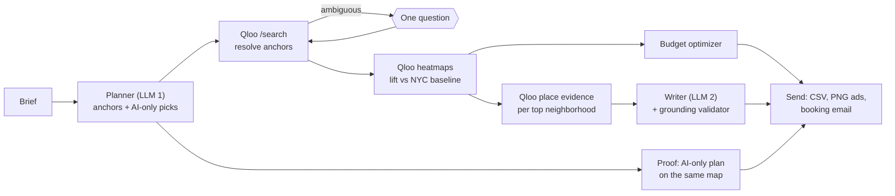

# Stoop — AI media planner for NYC street screens

> Most ad tech knows where phones go. Stoop knows what neighborhoods love.

**Try it:** [usestoop.vercel.app](https://usestoop.vercel.app) · no login ·
[60-second tour for judges](https://usestoop.vercel.app/judges) ·
[sample plan](https://usestoop.vercel.app/p/halfnote) ·
[how it works](https://usestoop.vercel.app/how-it-works)

Stoop is an AI agent for small businesses that want to advertise on New York's street screens (the
2,183 live, ad-capable LinkNYC kiosks). Describe your business, budget and dates. In about a minute
Stoop:

- finds the neighborhoods where your customers' taste over-indexes, using Qloo taste maps;
- picks the screens there that fit your budget;
- writes a different ad for each neighborhood, from that neighborhood's Qloo evidence;
- compares its plan with what the same AI would do without Qloo;
- drafts the booking email for you to send.

It never buys media or sends anything itself.

It tracks no one. Qloo receives taste anchors (artists, places, brands, films, shows) and New York
neighborhood shapes. It never receives the brief, the address or anything about people.

Built for the [Qloo Agentic Hackathon 2026](https://qloo.devpost.com/).

| | |
|---|---|
| Public demo | Live at [usestoop.vercel.app](https://usestoop.vercel.app) on Vercel |
| Qloo data | No working hackathon key yet, so every plan uses synthetic taste data and is labelled SYNTHETIC. The six sample plans are recorded runs of the live AI planner and writer on that synthetic data. The Qloo client has not been run against the live API; its 5-call contract check and 26-call calibration are ready for the first key |
| AI writers | Live on the demo: Groq's `gpt-oss-120b` on the free tier, with `gpt-oss-20b` when 120b is rate-limited. The chain also takes Gemini (only for visitors from allow-listed countries), Cloudflare Workers AI, SambaNova and OpenRouter `:free` models when their keys are set. Deterministic templates are the last fallback, labelled TEMPLATE |
| Source | MIT. Public from submission day |

## One run, seven stations

| Station | What happens | Who decides |
|---|---|---|
| **Brief** | Business, offer, budget, weeks, optional address. The address stays on Stoop's side | Owner |
| **Taste** | The agent proposes 2–6 taste anchors and matches them in Qloo search. If a name is ambiguous ("Soul": which one?), it asks one question | Model proposes, Qloo resolves |
| **Where** | A Qloo heatmap for each anchor, compared with an NYC baseline (rank-based lift), scored onto every live ad-capable kiosk in 106 eligible 2020 neighborhoods | Qloo measures, code ranks |
| **What** | For each top neighborhood, Qloo place evidence inside that neighborhood's polygon. Then two ads per neighborhood, every local phrase traced to an evidence item and checked against eight copy rules | Model writes, code verifies |
| **Plan** | The strongest screens per dollar, capped so no neighborhood takes more than half. Every price and impression figure is labelled ASSUMPTION. Also the six best free screens for LinkNYC's LinkLocal program | Code |
| **Proof** | The same brief planned by the same AI without Qloo, scored on the same map, with the circularity stated next to it | Code |
| **Send** | Checklist, CSV screen list, each ad as a print-ready 1080×1920 PNG, and a booking email that unlocks only after the owner confirms review | Owner |

Every result carries a provenance badge: LIVE, CACHED, RECORDED, TEMPLATE, QLOO ONLY or SYNTHETIC.
The agent log lists every Qloo request with each polygon redacted to a label, and copies a redacted
trace.

## How Stoop uses Qloo

| Step | Request | Why |
|---|---|---|
| Resolve anchors | `GET /search?query=…&types=urn:entity:<type>&take=5` (places: within 25 mi of NYC) | Exact, semantic or ambiguous match; at most one question per run |
| Taste maps | `GET /v2/insights?filter.type=urn:heatmap&filter.location=<NYC polygon>&signal.interests.entities=<anchor>` | One map per anchor, plus a calibrated baseline |
| Local evidence | `GET /v2/insights?filter.type=urn:entity:place&filter.location=<neighborhood polygon>&signal.interests.entities=<anchors>&feature.explainability=true` | What local places share with the anchors, for the ad copy |

Raw heatmap affinity mostly tracks popularity, so Stoop ranks by **lift**. Each map is rank-normalized
over the city grid, z = Φ⁻¹((rank − ½)/n), and the baseline map is subtracted:

$$\ell_a(g) = z_a(g) - z_b(g), \qquad L(g) = \frac{\sum_a w_a \, \ell_a(g)}{\sum_a w_a}$$

Before combining maps, the engine flags three problems and narrates each decision in the agent log:

- Qloo's generic "no data" map (detected by fingerprint, then excluded);
- maps that only follow density (down-weighted);
- thin maps (weighted by coverage).

Neighborhood scores use land-weighted aggregation, empirical-Bayes shrinkage and a confidence level.

Qloo quirks the client handles:

- **"New York" resolves to the state.** Stoop sends a city polygon instead.
- **4xx responses count against quota.** Every parameter is allow-listed locally first.
- **429s carry no Retry-After.** The client paces calls, counts every attempt against a quota ledger
  read from the rate-limit headers, and opens breakers on auth or quota failures.

Qloo is called only from server code. Responses are cached privately on the server and never
committed. Test fixtures are synthetic.

## The agent



The model interprets; code decides. A run makes two model calls (planner and writer). Everything
else is deterministic and tested:

- the lift engine;
- the grounding validator;
- the optimizer;
- the proof.

The run streams to the browser as typed data parts, keeps going if the visitor disconnects, and can
pause for the one question and resume. When any capacity limit is reached (fair-use limits, Qloo
quota, busy AI tiers), the visitor gets a labelled sample plan, never an error page.

## Does it work?

- **Validation against real stores: not run yet.** A backtest declared before any Qloo call compares
  Qloo taste maps with where 22 New York chains actually have more stores than commerce predicts
  (OpenStreetMap, ODbL). The OpenStreetMap side is built; the Qloo side needs about 44 calls and a
  working key, and its result will be published at `/validation` whatever it shows.
- **Copy rules with the live writer.** In the six recorded sample plans, `gpt-oss-120b` wrote all 36
  ads and all 36 passed the eight copy rules (on synthetic evidence).
- **Tests.** 635 unit and integration tests and 30 browser tests run in CI on every push. The
  browser tests run on the production build and include axe accessibility checks on 11 pages. CI
  also runs a public-data audit and a gitleaks scan of the full history.

## Privacy and what Stoop will not do

- Track people: no device IDs, location trails, ad cookies or third-party trackers.
- Send anything about the business owner or their customers to Qloo.
- Infer race, ethnicity, religion, health, sexuality or politics, or use audience segments to choose
  neighborhoods.
- Plan political, housing, employment, credit, health-claim, tobacco, weapons, adult or gambling ads.
  Choosing neighborhoods by taste could exclude people along lines the law protects.
- Put a real person's name or face, or another brand's mark, in an ad.
- Buy media or send email by itself.
- Promise results. All prices and impressions are labelled assumptions.

Details: [data and privacy](docs/DATA_AND_PRIVACY.md).

## Run it locally (no keys needed)

```bash
pnpm install
pnpm build && pnpm start      # or: pnpm dev
# open http://localhost:3000/plan/new
```

Without keys Stoop runs fully in **mock mode**: synthetic Qloo data, the deterministic writer and an
in-memory store, every result labelled SYNTHETIC. [.env.example](.env.example) lists the live settings
(placeholders only); [docs/DEPLOYMENT.md](docs/DEPLOYMENT.md) covers Vercel, Upstash and the first-key
runbook.

## Checks

```bash
pnpm typecheck && pnpm lint
pnpm test                                  # unit + integration (mock pipeline, run API, admin)
pnpm build && pnpm exec playwright test    # browser tests on the production build
pnpm audit:public                          # secrets, Qloo data and private paths
pnpm qloo:smoke --dry-run                  # first-key calibration plan (26 calls, hard stop 30)
pnpm backtest:run --dry-run                # validation backtest plan (about 2 Qloo calls per chain)
```

## Stack

Next.js 16 (App Router) on Vercel, Vercel AI SDK 7, Upstash Redis, MapLibre GL on OpenFreeMap tiles,
zod, Vitest and Playwright. The Qloo client calls the REST API directly from the server. Street screens
and neighborhoods come from NYC Open Data and are processed at build time. Built solo during the event
with AI coding agents.

## Documentation

- [Product](docs/PRODUCT.md) · [Architecture](docs/ARCHITECTURE.md) · [Data and privacy](docs/DATA_AND_PRIVACY.md)
- [Deployment](docs/DEPLOYMENT.md) · [Research and sources](docs/RESEARCH.md)
- [Submission checklist](docs/SUBMISSION.md) · [Provenance and decisions](docs/PROVENANCE.md)
- [Third-party notices](THIRD_PARTY_NOTICES.md) · [Data sources](data/README.md)

## Known limitations

- No live Qloo data yet. Until a key works, the demo's neighborhoods, evidence and comparison come from
  synthetic data and say nothing about real New York taste.
- New York City only. Screen locations are an open-data snapshot; whether a screen can be bought,
  and when, is up to the seller.
- Taste maps are relative signals at roughly block resolution, not foot traffic, visits or population.
- The PROOF comparison is scored on the same maps Stoop optimizes, so it is partly circular; the
  validation backtest is the independent check.
- Prices and impressions are assumptions, not quotes. No campaign has run yet.
- Free AI tiers run out. Templates then write the ads from the same evidence, and the plan says so.

## Data and licenses

Street screens and neighborhoods come from NYC Open Data (LinkNYC Locations `s4kf-3yrf`, 2020
Neighborhood Tabulation Areas `9nt8-h7nd`, Borough Boundaries `gthc-hcne`). The basemap is
OpenFreeMap / OpenMapTiles, © OpenStreetMap contributors. Taste data comes from the Qloo Insights API
at run time; no Qloo response data is stored in this repository. The validation uses OpenStreetMap
data under the ODbL and publishes summary statistics only. Stoop is not affiliated with LinkNYC,
Intersection, CityBridge or the City of New York.

Code: [MIT](LICENSE). Third-party code, data and services keep their own terms
([notices](THIRD_PARTY_NOTICES.md)).
